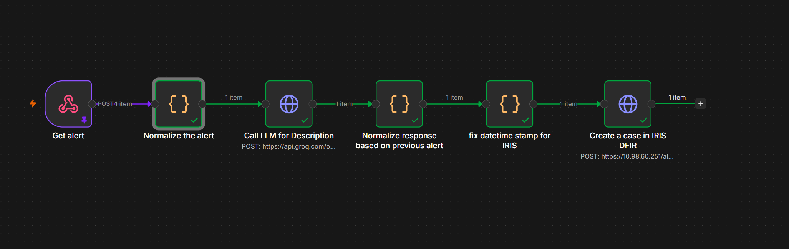
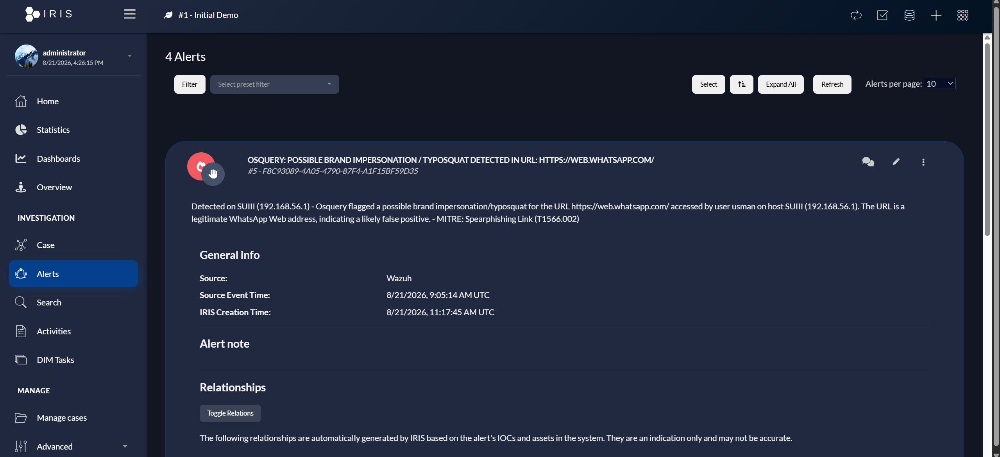
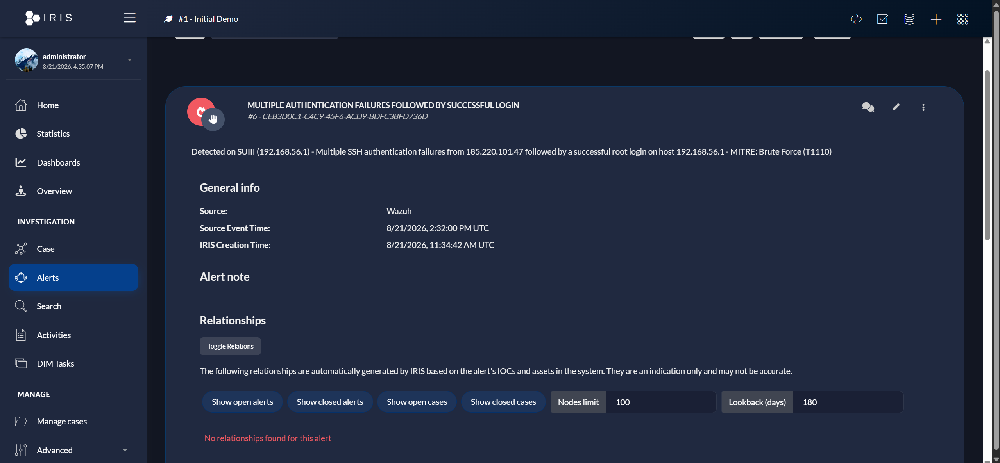
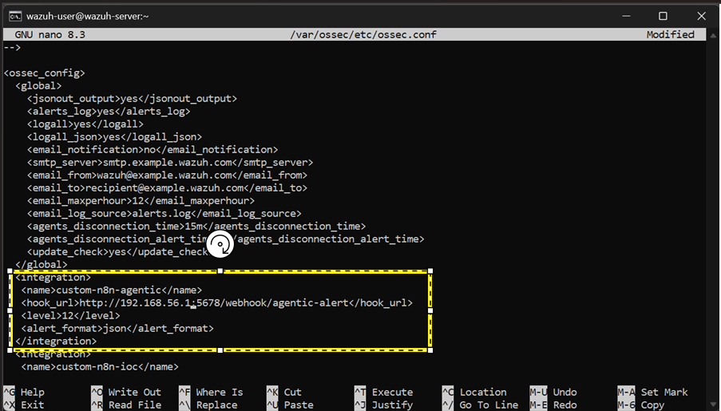

# Wazuh + n8n Agentic AI SOC Triage

An agentic AI layer on top of a Wazuh to DFIR-IRIS automation pipeline. High severity Wazuh alerts are sent through n8n to an open-source LLM (served via Groq), which classifies each alert as a **True Positive** or **False Positive**, scores its confidence, maps it to **MITRE ATT&CK**, and writes a structured analyst report. The enriched result is then automatically created as a case in **DFIR-IRIS**, with no manual triage step.

## Architecture

```
Wazuh (High Severity Alert, level 12+)
   -> Webhook (n8n)
   -> Normalize the alert
   -> Call LLM for Description   (Groq API, openai/gpt-oss-120b)
   -> Normalize response based on previous alert
   -> Fix datetime stamp for IRIS
   -> Create a case in IRIS DFIR
```



## Why

Most SIEM-to-case-management automation just forwards alerts verbatim, severity level and all, leaving the actual triage decision (is this real, how confident am I, what do I do about it) entirely to the analyst. This pipeline moves that first triage pass into the workflow itself: the AI reads the alert in context, reasons about it, and hands the analyst a pre-classified case with a MITRE mapping and concrete next steps already attached.

## Components

| Stage | Tool | Purpose |
|---|---|---|
| Alert source | Wazuh Manager | Detects and forwards high severity alerts via a custom `ossec.conf` integration block |
| Orchestration | n8n | Webhook intake, data normalization, API calls, response parsing |
| Reasoning | Groq API (`openai/gpt-oss-120b`) | Classifies True/False Positive, scores confidence, maps MITRE ATT&CK, writes recommendations |
| Case management | DFIR-IRIS | Stores the final alert as a case, AI report embedded in the description |

## Workflow walkthrough

1. **Get alert (Webhook)** — receives the raw Wazuh alert as POST JSON.
2. **Normalize the alert** — flattens Wazuh's deeply nested JSON (including osquery-sourced alerts) into a consistent object: rule info, agent info, MITRE fields, source/destination, flagged URL, raw log.
3. **Call LLM for Description** — sends the normalized alert to Groq with a system prompt instructing the model to respond as a SOC Tier-2 analyst, returning strict JSON: `alert_summary`, `classification`, `confidence_score`, `ioc_analysis`, `mitre_attack`, `immediate_actions`, `security_recommendations`.
4. **Normalize response based on previous alert** — parses the AI's JSON (stripping stray markdown fences if present) and merges it back with the original alert fields.
5. **Fix datetime stamp for IRIS** — reformats the timestamp, since IRIS's API rejects Wazuh's native `+0000` offset format.
6. **Create a case in IRIS DFIR** — posts the combined payload to IRIS's `/alerts/add` endpoint, mapping the AI's findings into the case description and deriving severity from the Wazuh rule level.

## Validation

The pipeline was tested against two contrasting real alerts to confirm the AI performs genuine per-alert reasoning rather than defaulting to one outcome.

| Test Alert | Classification | Confidence | MITRE Mapping |
|---|---|---|---|
| Osquery brand-impersonation detection on `web.whatsapp.com` (legitimate domain, overly broad rule) | **False Positive** | 80% | T1566.002 — Spearphishing Link |
| SSH brute force: 8 failed logins then a successful root login from an external IP | **True Positive** | 94% | T1110 — Brute Force |

<table>
<tr>
<td></td>
<td></td>
</tr>
<tr>
<td align="center"><sub>IRIS case: AI-classified False Positive</sub></td>
<td align="center"><sub>IRIS case: AI-classified True Positive</sub></td>
</tr>
</table>

## Setup

### 1. Wazuh

Add the integration block in [`wazuh-config/ossec-integration-snippet.conf`](wazuh-config/ossec-integration-snippet.conf) inside `<ossec_config>` in `/var/ossec/etc/ossec.conf`, pointing `hook_url` at your n8n webhook. Restart the manager:

```bash
systemctl restart wazuh-manager
```



### 2. n8n

Import [`workflow/wazuh-agentic-triage.json`](workflow/wazuh-agentic-triage.json) into n8n. You'll need to configure:
- A **Groq API key** (header auth credential) for the "Call LLM for Description" node.
- A **DFIR-IRIS API key** (header auth credential) for the "Create a case in IRIS DFIR" node.
- Your IRIS instance URL in the final HTTP Request node.

### 3. DFIR-IRIS

Have an IRIS instance running with an API key generated for the account n8n will authenticate as. Severity and status IDs are environment-specific; confirm yours under IRIS's alert settings before relying on the default mapping in the workflow.

## Repository structure

```
.
├── README.md
├── LICENSE
├── docs/
│   ├── report/            # Full written report (architecture, debugging log, validation)
│   └── screenshots/       # Node-by-node and case screenshots referenced above
├── workflow/
│   └── wazuh-agentic-triage.json   # Importable n8n workflow
└── wazuh-config/
    └── ossec-integration-snippet.conf
```

## Full report

A complete write-up, including the architecture rationale, the debugging log (JSON body errors, datetime formatting, field mapping fixes), and full validation detail, is in [`docs/report/Task_8_Wazuh_n8n_Agentic_AI_Report.docx`](docs/report/Task_8_Wazuh_n8n_Agentic_AI_Report.docx).

## Notes

- Model used: `openai/gpt-oss-120b`, served via Groq for low-latency inference. Any Groq-hosted model that reliably returns structured JSON can be substituted.
- Temperature is set low (0.2) to keep classification behavior consistent across repeated runs on the same alert type.
- This builds on an earlier, simpler Wazuh-to-IRIS forwarding pipeline (no AI layer) that used static severity-band mapping; this version replaces that static logic with actual per-alert reasoning.

## Author

Usman Javaid
SOC Analyst Intern, ITSOLERA (PVT) LTD
